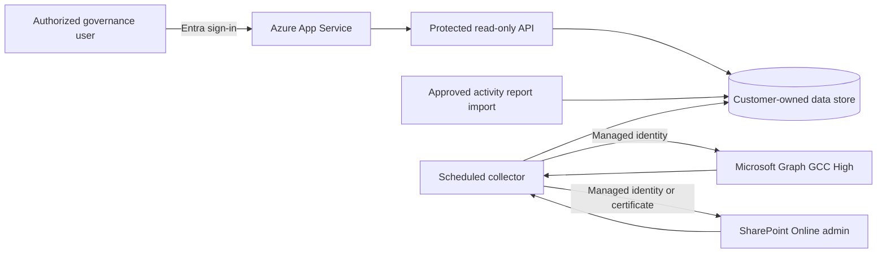

# Customer deployment and tenant connection

This guide describes the production path for installing the dashboard in a customer's GCC High environment. The current `index.html` is a browser-only prototype with sample governance records. Installing that file by itself does not connect it to Microsoft 365.

## Recommended architecture

Deploy the solution into a customer-owned Azure Government subscription:

- **Azure App Service** serves the dashboard and its protected API.
- **A scheduled collector** runs daily and writes normalized snapshots. Azure Functions is suitable when it is available in the customer's approved Azure Government region; otherwise use an App Service WebJob or approved automation host.
- **Customer-owned storage** holds only the fields needed by the dashboard. Azure Storage is sufficient for a small deployment; Azure SQL is appropriate when the customer requires relational reporting and longer history.
- **Microsoft Entra authentication** restricts the web app to an approved customer governance group.
- **Read identities are separate from user access.** Browser code never receives an application credential or tenant-wide Graph token.
- **Remediation is not part of the first deployment.** Any future write action needs a separate execute identity, approval workflow, dry run, policy checks, and audit record.

Use GCC High endpoints throughout:

| Service | Endpoint |
| --- | --- |
| Azure portal | `https://portal.azure.us` |
| Entra authority | `https://login.microsoftonline.us/{tenant-id}` |
| Microsoft Graph | `https://graph.microsoft.us/v1.0` |
| Azure management | `https://management.usgovcloudapi.net/` |
| SharePoint | The customer's `*.sharepoint.us` tenant URLs |

Do not substitute commercial `.com` endpoints in application configuration.

## Customer prerequisites

Before deployment, obtain written confirmation of:

- An Azure Government subscription, approved region, resource group owner, naming convention, and tags.
- The customer's tenant ID, primary domain, and SharePoint admin-center URL. These are identifiers, not secrets.
- An Entra administrator who can create app registrations, grant application consent, and assign access to the dashboard.
- A SharePoint Administrator who can validate site inventory and Restricted Content Discovery reporting.
- An approved data service: Azure Storage, Azure SQL, Cosmos DB, or another customer standard.
- The customer security group's decision on public App Service ingress with Entra authentication versus private networking.
- Retention, logging, monitoring, and deployment-pipeline requirements.
- The Team-level activity source actually available in that GCC High tenant.

If Conditional Access requires a secure AVD, perform the portal, Azure CLI, Graph, and SharePoint administration work from that AVD.

## Identity design

Use at least two security principals:

1. **Dashboard sign-in app**: authenticates users to the web application/API. It has no tenant inventory application permissions. Access is assigned only to a customer-managed governance group.
2. **Read-only collector identity**: a managed identity is preferred when the chosen SharePoint tooling supports it. Otherwise use a certificate credential stored in customer-controlled Key Vault. Do not use a client secret for the production collector.

For stricter separation, give the SharePoint/RCD collector its own managed identity because SharePoint administration can require a broader role than Graph inventory.

Start with only the application permissions required by the pilot queries. The expected Graph permission set must be reviewed against the exact endpoints before consent, but typically includes read access for groups, Teams, Team members, channels, channel members, and channel file locations. Candidate permissions include:

- `Group.Read.All`
- `Team.ReadBasic.All`
- `TeamMember.Read.All`
- `Channel.ReadBasic.All`
- `ChannelMember.Read.All`
- `Files.Read.All` or `Sites.Read.All` when resolving channel file locations

Some endpoints offer resource-specific consent permissions, but those require per-Team installation or consent and may not fit a tenant-wide inventory. Do not grant write permissions or `Directory.ReadWrite.All` for the read-only release.

The SharePoint Online Management Shell supports unattended connections using managed identity or an application certificate. For GCC High, use the customer's `*.sharepoint.us` admin URL and `-Region ITAR`. The customer administrator must approve the identity and the minimum SharePoint role/permissions needed for the selected inventory and RCD cmdlets.

## Installation sequence

### 1. Validate the tenant before building

Run a short proof of access against a customer-approved pilot containing a standard channel, private channel, shared channel, guest, and known SharePoint exposure condition.

Validate that the proposed identity can read:

- Microsoft 365 Groups that are provisioned as Teams.
- Team properties, owners, members, guests, and archive state.
- Standard, private, and shared channel inventory and direct membership.
- Each channel's file location and associated SharePoint site.
- SharePoint site sharing/exposure fields needed for the agreed risk rules.
- Restricted Content Discovery status and report output, if licensed and enabled.

This proof is the permission gate. Remove any permission that is not exercised, and document any field that cannot be obtained in the customer's cloud.

### 2. Create customer-owned Azure resources

In `https://portal.azure.us`, create or select:

- Resource group.
- App Service plan and web app for the dashboard/API.
- Function App, WebJob, or approved scheduler for collection.
- Storage account or approved database.
- Key Vault only when certificate material or other secrets are required.
- Application Insights and Log Analytics, subject to customer policy.

Use managed identities, HTTPS-only access, TLS 1.2 or later, diagnostic logs, resource locks where required, and the customer's standard private endpoint/network controls.

### 3. Configure dashboard authentication

Create a single-tenant Entra app registration for dashboard sign-in and configure App Service Authentication against the GCC High tenant. Require authentication for every route, including the API. Set **Assignment required** on the enterprise application and assign only the approved governance group.

The API must validate the token issuer, tenant, audience, and expiration. Do not rely on hidden navigation or frontend checks for authorization.

### 4. Configure the collector identity

Enable a managed identity on the collector host. A customer Entra administrator grants the reviewed Microsoft Graph application permissions and admin consent. If the SharePoint module or customer policy requires certificate authentication instead, upload the public certificate to the app registration and store the private certificate in customer-controlled Key Vault.

Never place a token, client secret, PFX file, or private certificate in this repository, browser storage, App Service source files, chat, or email.

### 5. Deploy the API and normalized store

The collector should write snapshots rather than expose Graph directly to the browser. At minimum, store:

- Workspace and Team IDs, display name, archive state, and classification fields.
- Owners, member and guest counts, and channel counts.
- Private/shared channel membership indicators needed for governance review.
- Parent Team site and private/shared channel site identifiers and URLs.
- Agreed SharePoint exposure and RCD fields.
- Activity bucket, source, source timestamp, and collection timestamp.
- Collector run status, partial failures, and data-quality warnings.

Return `Unknown` when a source is missing, stale, unsupported, or failed. Never translate missing activity into `Inactive`.

Expose a read-only endpoint such as `GET /api/workspaces` and replace the hardcoded `governanceWorkspaces` array in `index.html` with that response. Keep a clearly labeled sample-data fallback only for demonstration mode.

### 6. Add collection in stages

Use this order so each source can be reconciled independently:

1. Graph group, Team, owner, member, guest, and channel inventory.
2. Channel file-location correlation to parent and channel SharePoint sites.
3. SharePoint administration exposure fields.
4. Restricted Content Discovery status and report data.
5. Customer-approved Team-level activity source.

Microsoft Graph's standard Teams team-activity report API is not available in GCC High. Do not advertise daily activity until the customer validates a supported admin report, an approved audit-derived aggregate, or a controlled import. Display the selected source and its timestamp in the UI.

### 7. Reconcile the pilot

Compare dashboard output with Teams admin center, SharePoint admin center, and the approved activity source for the pilot. Record expected counts and investigate every mismatch before expanding scope.

Acceptance criteria:

- All pilot Teams appear exactly once.
- Owners, members, guests, and channels match authoritative admin views.
- Parent, private-channel, and shared-channel SharePoint sites correlate correctly.
- Missing or unsupported values display as `Unknown` with a reason.
- The API rejects unauthenticated users and users outside the approved group.
- Collector failures are logged and do not overwrite a good snapshot with empty data.
- No write permission or remediation endpoint exists.

### 8. Promote to production

After customer sign-off, expand collection to the full tenant, schedule daily runs, configure failure alerts, set retention, document identity/certificate rotation, and hand over an operations runbook. Record source-specific refresh timestamps because a daily collector does not make every upstream source real time.

## What the customer must do

The customer retains control of the subscription, app registrations, admin consent, governance-group membership, data store, monitoring, and credentials. The implementation team can deploy code and infrastructure under delegated access, but the customer's authorized administrators should perform or approve all consent and role assignments.

## Decisions needed to start

Provide these four answers before creating deployable infrastructure:

1. Which customer Azure Government subscription and approved region will host the app?
2. Which storage service is approved: Azure Storage, Azure SQL, Cosmos DB, or another platform?
3. Can an Entra administrator grant application permissions and can a SharePoint Administrator support the pilot?
4. Which Team-level activity report or audit source is available and approved in the customer's GCC High tenant?

The first production milestone should be a read-only pilot for 5-10 representative Teams, not a tenant-wide rollout.